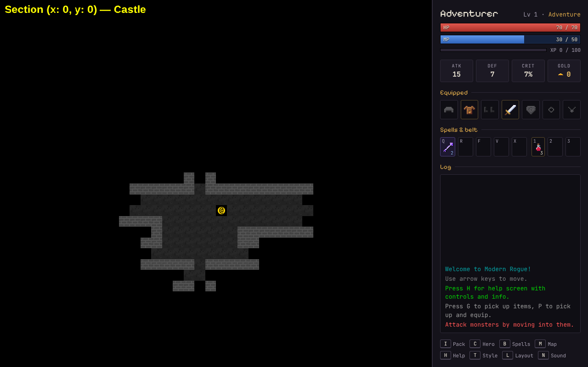
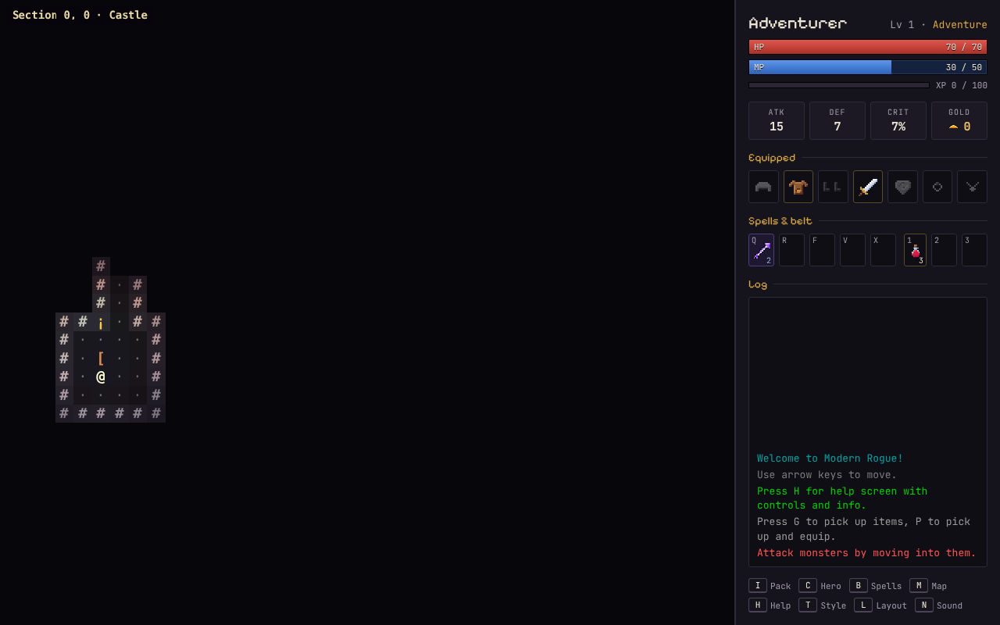

# Modern Rogue Classic

**The free, open edition of Modern Rogue** | Classic 1.0 (based on 0.6.0 "Torchlight")

A roguelike built with vanilla JavaScript and HTML5 Canvas: procedurally generated dungeons, tactical combat, a magic system and an open world to explore. This edition is frozen; it gets occasional fixes but no new features.

Its successor, **Below Emberwick**, with 16-bit pixel art and lighting, the descent beneath the town of Emberwick, bosses and more, is developed separately as a commercial game.

## 🎮 Features

- **Two display styles**: Classic tiles (default) or ASCII; press T to switch
- **Magic System**: 10 spells across offensive, healing, and utility categories with projectile-based combat
- **Spell Scaling**: Intelligence-based damage scaling with level bonuses for character progression
- **Status Effects**: Damage over time, healing over time, buffs, debuffs, stun, and slow effects
- **Tactical Combat**: Turn-based combat with melee, ranged and spellcasting monsters
- **Character Progression**: Stat point allocation enabling wizard, warrior, and hybrid builds
- **Procedural Generation**: Dynamically generated dungeons with gates and keys
- **Dungeon Themes**: Cave, castle, and crypt sections with theme-specific monster spawns
- **Open World**: An unbounded grid of sections, with a world map (M)
- **Save & Continue**: Local saves (IndexedDB) with manual save (Ctrl+S) and autosave on section transitions
- **Run Modes**: Adventure (death resumes from the last save) or Hardcore (death erases the save)
- **HUD Layouts**: Sidebar or bottom action bar, picked in Options or cycled with L
- **Generated Audio**: Themed music and sound effects synthesized live with Web Audio (no audio files)

<p>
  
  
</p>

## 🚀 Getting Started

### Prerequisites

- Node.js (v20 or higher, required by the test tooling)
- npm or yarn package manager
- Modern web browser

### Installation

1. Clone the repository:
```bash
git clone https://github.com/EdwardAThomson/Roguelike.git
cd Roguelike
```

2. Install dependencies:
```bash
npm install
```

3. Start the development server:
```bash
npm start
```

4. Open your browser and navigate to `http://localhost:8080` (or the port specified)

**For development with cache disabled:**
```bash
npx http-server . -p 8080 -c-1 -o
```

## 🎯 How to Play

### Controls

- **Arrow Keys**: Move your character
- **G**: Pick up items
- **E**: Equip items
- **I**: Toggle inventory
- **C**: Toggle character screen
- **B**: Toggle spellbook
- **H**: Toggle help screen
- **T**: Switch between Classic and ASCII
- **Ctrl+S**: Save the game (also autosaves when changing sections)
- **Esc**: Close any open screen
- **M**: Open the map (Area view of this section, World view of every visited section; 1/2 or Tab to switch)
- **Shift+M**: Toggle map reveal (debug/cheat mode)
- **Shift+G**: Show gate debug information

### Gameplay

1. **Movement**: Use arrow keys to move through the dungeon
2. **Combat**: Attack monsters by moving into them
3. **Items**: Pick up items with 'G' and equip them with 'E'
4. **Exploration**: Uncover the map as you move through areas
5. **Progression**: Advance through different dungeon levels and areas

## 🏗️ Project Structure

```
src/
├── js/
│   ├── main.js              # Main game loop and initialization
│   ├── menu.js              # Main menu system
│   ├── config.js            # Cloud/account config (empty = fully offline)
│   └── modules/
│       ├── dungeon.js       # Dungeon generation
│       ├── renderer.js      # Game rendering
│       ├── gameStateManager.js  # Game state management
│       ├── cameraManager.js     # Camera and viewport
│       ├── fovManager.js        # Field of view calculations
│       ├── combatManager.js     # Combat system
│       ├── inputManager.js      # Input handling
│       ├── worldManager.js      # World sections and transitions
│       ├── entity/
│       │   ├── player.js        # Player character
│       │   ├── monster.js       # Monster entities
│       │   └── monsterDatabase.js # Monster definitions
│       ├── items/
│       │   ├── itemManager.js   # Item management
│       │   ├── inventory.js     # Inventory system
│       │   ├── item.js          # Base item class
│       │   └── equipment.js     # Equipment system
│       ├── persistence/
│       │   ├── saveManager.js   # Save/load policies (manual save, autosave, death)
│       │   ├── serializer.js    # Game state -> save JSON
│       │   ├── hydrator.js      # Save JSON -> live game
│       │   └── saveStore.js     # Storage adapter (IndexedDB / in-memory / cloud)
│       └── ui/
│           ├── gameModal.js     # Unified tabbed modal (Character/Inventory/Spellbook)
│           ├── gameUI.js        # Main game UI
│           ├── inventoryUI.js   # Inventory interface
│           ├── spellbookUI.js   # Spellbook and hotkey binding
│           └── helpScreen.js    # Help system
└── css/
    ├── style.css            # Main game styles
    └── menu.css             # Menu styles
```

## 🔧 Development

### Architecture

The game follows a modular architecture with clear separation of concerns:

- **Game Loop**: Handles updates and rendering
- **State Management**: Manages game states (playing, paused, game over)
- **Entity System**: Player, monsters, and items
- **World System**: Dungeon generation and world management
- **UI System**: User interface components
- **Input System**: Input handling and key bindings

### Key Components

- **GameStateManager**: Manages overall game state
- **CameraManager**: Handles viewport and camera movement
- **FOVManager**: Calculates field of view and visibility
- **CombatManager**: Handles all combat interactions
- **WorldManager**: Manages world sections and transitions
- **ItemManager**: Handles item interactions and inventory
- **SaveManager**: Owns save/load policy — manual save, autosave on section transitions, and death handling per run mode

### Testing

```bash
npm test             # Vitest unit + integration tests (headless, no browser needed)
npm run test:watch   # Vitest in watch mode
npm run test:e2e     # Playwright smoke test (auto-starts http-server on :8080)
```

Unit tests (`test/*.test.js`) cover pure game logic such as pathfinding and combat math. Integration tests (`test/integration/`) boot a headless "fake game" harness (`test/helpers/fakeGame.js`) that wires up the real managers to catch cross-manager bugs. The end-to-end tests (`test/e2e/*.spec.js`) load the game in headless Chromium and drive real keystrokes: `smoke.spec.js` (boot + input), `saveload.spec.js` (save, reload, Continue with real IndexedDB), and `gameModal.spec.js` (tabbed game menu). Run `npx playwright install chromium` once before the first local run.

## 📚 Documentation

Additional documentation can be found in the `documentation/` folder:

- `functionality_documentation.md` - Core game mechanics
- `dungeon_generation.md` - Dungeon generation algorithms
- `magic_system.md` - Magic system reference and spell database
- `spell_scaling_implementation.md` - Spell scaling and progression system
- `versioning.md` - Version management and release workflow
- `CHANGELOG.md` - Complete version history and roadmap
- `multiplayer_roadmap.md` - Future multiplayer features
- `player_guide.md` - Comprehensive player guide

The narrative development log lives at [`DEVLOG.md`](DEVLOG.md) in the repo root (per-date notes, newest first).

## 🎥 YouTube Dev Log

- [I vibe coded a Roguelike game with Claude Code](https://youtu.be/y9RRpOgV9yg)

## 🎵 Acknowledgments

- Built with vanilla JavaScript for maximum compatibility
- Inspired by classic roguelike games
- Uses HTML5 Canvas for rendering
- Modular design for easy extension and maintenance

## 📜 Licence

The code is licensed under the GNU General Public License v3.0 or later (see [`LICENSE`](LICENSE)). The fonts in `assets/fonts/` are under the SIL Open Font License. The "Modern Rogue" and "Below Emberwick" names and Octonion Games branding are not covered by the licence; see [`NOTICE`](NOTICE).
